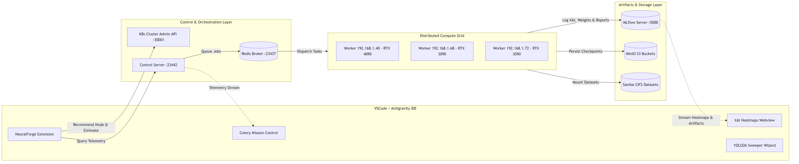

<p align="center">
  <a href="https://linkedin.com/in/wisrovi-rodriguez"></a>
  <a href="https://wisrovi.dev"></a>
  <a href="https://orcid.org/0009-0005-0710-1861"></a>
  <a href="https://opensource.org/licenses/MIT"></a>
</p>

# 🚀 NeuralForge Studio: YOLO & Cluster MLOps Suite

[](https://github.com/wisrovi/wyoloservice2_extension)
[](https://code.visualstudio.com/)
[](LICENSE)
[](https://github.com/wisrovi)

The official enterprise IDE extension for the **train_service2** ecosystem. Designed and architected by **William Rodriguez (Wisrovi)**, **NeuralForge Studio** transforms complex distributed AI infrastructure into a clean, human-centric, 3-step daily workflow for Computer Vision engineers and ML researchers.

Whether running in **VSCode**, **Google Antigravity**, or remote browser **code-server** instances, NeuralForge Studio eliminates DevOps friction: launch next-generation **YOLO26**, **YOLO11**, **YOLOv10**, **YOLOv9**, **YOLOv8**, or **RT-DETR** model training with intuitive presets, inspect live experiments with real-time loss curves, review **Explainable AI (Eigen-CAM)** heatmaps, interact with "Live YAML" (YAML Vivo) in-editor CodeLens controls to dynamically switch target GPU worker nodes, computer vision task styles, optimization metrics, and priority queues, and download production model checkpoints (`best.pt`) directly into your open workspace with one click.

---

## 📖 Table of Contents
1. [NeuralForge Studio: Daily User Workflows](#-neuralforge-studio-daily-user-workflows)
2. [Architecture & Data Flow](#-architecture--data-flow)
3. [Key Technologies and Libraries](#-key-technologies-and-libraries)
4. [Core Feature Deep Dive](#-core-feature-deep-dive)
5. [Command Palette Reference](#-command-palette-reference)
6. [Configuration & Settings](#-configuration--settings)
7. [End-to-End Workflow Guide](#-end-to-end-workflow-guide)
8. [Building and Packaging](#-building-and-packaging)
9. [License & Commercial Terms](#-license--commercial-terms)
10. [Author & Official Affiliation](#-author--official-affiliation)

---

## 🎨 NeuralForge Studio: Daily User Workflows

Rather than overwhelming standard practitioners with low-level sysadmin metrics, **NeuralForge Studio** structures the sidebar around the real daily lifecycle of machine learning development:

```
┌────────────────────────────────────────────────────────┐
│  NEURALFORGE STUDIO                                    │
├────────────────────────────────────────────────────────┤
│  ▼ 🚀 TRAINING HUB (QUICK START)                       │
│    ▶ 🚀 Start New Training (Guided Launcher)           │
│    ▶ 🔍 Check & Validate Dataset Path                  │
│    ▶ ⚙️ Advanced Configuration (Optuna Sweeper)        │
│    ▶ 🟢 Cluster Ready: 12 GPU Nodes Online             │
├────────────────────────────────────────────────────────┤
│  ▼ 📋 MY EXPERIMENTS & RUNS                            │
│    ▼ 🟢 [RUNNING] Test_AREPO_ProtSup_v3                │
│      ▶ 📊 View Live Loss & Metrics Curves              │
│      ▶ 📜 Tail Real-Time Logs                          │
│      ▶ ⏹️ Abort / Cancel Study                         │
├────────────────────────────────────────────────────────┤
│  ▼ 🏆 MODELS & RESULTS GALLERY                         │
│    ▼ 🏆 Test_AREPO_ProtSup_v3 [mAP50: 0.932]           │
│      ▶ ⬇️ Download best.pt to Workspace                │
│      ▶ 🔥 View Explainable AI Heatmaps (CAM)           │
│      ▶ 📈 View Evaluation Curves & Confusion Matrix    │
│      ▶ 📄 Open Executive Report (.docx)                │
├────────────────────────────────────────────────────────┤
│  ▶ ⚙️ CLUSTER INFRASTRUCTURE (ADVANCED)                │
│    (Collapsed by default: Node telemetry, TDP, sockets)│
└────────────────────────────────────────────────────────┘
```

1. **🚀 Training Hub (Quick Start):**
   - **Multi-Generation Studio Launcher (`neuralforge.guidedLaunch`):** Visual single-screen wizard with dataset presets, dynamic CV task selector (`detect`, `segment`, `classify`, `obb`, `pose`), multi-generation model family selector (**YOLO26**, **YOLO11**, **YOLOv10**, **YOLOv9**, **YOLOv8**, **RT-DETR**, or custom `.pt` paths), fully adjustable epochs, batch sizes, image sizes, optimizers, learning rate, and persistent cluster & Samba CIFS credentials.
   - **Pre-flight Dataset Validator (`neuralforge.validateDataset`):** Checks train/val folder structure, YOLO label format, and bounding boxes on Samba CIFS or local disks before wasting GPU compute.
   - **Cluster Readiness Status:** Real-time indicator displaying active GPU nodes ready for allocation.

2. **📋 My Experiments & Runs:**
   - **Active Study Tracker:** Live cards for active and queued jobs across the distributed cluster.
   - **Instant Telemetry Shortcuts:** One-click live SVG loss curves, log tailing, and safe graceful cancellation (`neuralforge.cancelStudy`).

3. **🏆 Models & Results Gallery:**
   - **One-Click Model Export (`neuralforge.downloadModelWeights`):** Directly places `models/<study_id>_best.pt` into your active VSCode workspace root.
   - **Interactive XAI Heatmaps (`neuralforge.viewHeatmaps`):** Visualizes deep feature focus overlays and Deletion AUC fidelity scores.
   - **Evaluation Curves & Reports:** Instant confusion matrix, mAP50 progressions, and downloadable `.docx` executive summaries.

4. **📄 In-Editor Interactive YAML CodeLens:**
   - NeuralForge injects interactive buttons directly into any training YAML editor:
     - `▷ Launch Training on Cluster`: Dispatches the file directly to the Central API / Celery Manager.
     - `▤ Select Target Node / GPU`: Interactive QuickPick querying live cluster nodes (IPs, VRAM, temp, load).
     - `▤ Target Worker: <node> (Click to Switch Node)`: Directly switches the destination GPU worker in the code.
     - `▷ View Status & Curves [<study_id>]`: Real-time loss curves once launched.
     - `▤ Tail Logs`: Worker container stdout tailing.
     - `🛑 Cancel Study`: Graceful job abortion.

5. **⚙️ Cluster Infrastructure (Advanced):**
   - Kept neatly collapsed for engineers who need deep hardware telemetry: VRAM consumption gauges, GPU core load %, operating temperatures (°C), power draw vs. TDP wattage, node diagnostics (`neuralforge.diagnoseNode`), and cluster-wide Docker image pulls (`neuralforge.triggerBroadcastPull`).

---

## 🏛️ Architecture & Data Flow

<p align="center">
  
</p>

---

## 🛠️ Key Technologies and Libraries

The NeuralForge extension is built upon modern IDE, networking, and visualization technologies:

- **VSCode Extension API (`^1.80.0`):** Native editor integration providing custom Activity Bar views, hierarchical TreeDataProviders, bidirectional Webview message passing, dynamic CodeLens, QuickPick node routing, and configuration schemas.
- **TypeScript (`^6.0.0`):** Strictly-typed codebase delivering strict null checks, clean interfaces, and robust compile-time guarantees across all telemetry providers.
- **Webpack 5:** Industrial-grade bundling, dead-code elimination, and tree-shaking that compiles all providers and styles into an optimized, self-contained `dist/extension.js` production artifact.
- **Node.js Asynchronous HTTP Client:** Non-blocking asynchronous network communication interfacing with both the Kubernetes Cluster Admin NodePort (`:30001`) and Celery Control Server REST endpoints (`:23442`).
- **HTML5 & CSS3 Responsive Webviews:** Hardware-accelerated, theme-adaptive user interfaces adhering to native VSCode design variables (`--vscode-*`) for the Guided Training Studio, XAI Heatmaps Explorer, and Metrics Curves.
- **JSON Schema (Draft-07):** Schema specification providing automated autocomplete, inline documentation tooltips, and strict linting for YOLO26 training descriptors and Optuna Sweeper v2 configurations.

---

## 🚀 Core Feature Deep Dive

### 1. 🚀 Multi-Generation Guided Training Studio (`neuralforge.guidedLaunch`)
* **Multi-Family & Multi-Task Driven:** Supports **YOLO26**, **YOLO11**, **YOLOv10**, **YOLOv9**, **YOLOv8**, **RT-DETR**, or custom model checkpoints across **Detection**, **Segmentation**, **Classification**, **OBB**, and **Pose**. Weights and suffixes update automatically (`yolo11s-seg.pt`, `yolo26n-cls.pt`, etc.).
* **Pure & Minimal YAML Generation:** Generates standardized `train_service2` YAML descriptors stripped of boilerplate and unused hyperparameters (`batch`, `patience`, `conf`, `iou`, etc.), focusing cleanly on `data`, `epochs`, `imgsz`, and `optimizer`.
* **Single Run vs. Optuna Sweeper:** Toggle between single runs or automated multi-trial Optuna Sweepers (with TPE / CMA-ES samplers and custom objective metrics).
* **Direct "Generate YAML & Open in Editor" Flow:** Creates the official descriptor in your workspace and immediately opens it side-by-side with full "Live YAML" (YAML Vivo) interactive CodeLens active for review before launching.
* **Connection & Samba Storage Panel:** Configure and remember your Cluster Manager IP, Port, and remote Samba CIFS credentials without re-entering them every session.

### 2. 📄 Interactive "Live YAML" (YAML Vivo) CodeLens Engine
* **Target Worker Switching (`neuralforge.pickTargetWorkerNode`):** Click the inline CodeLens above `debug:` or `target_worker:` to open an interactive QuickPick listing all live cluster invokers with their physical GPUs, free VRAM, and temperatures. Selecting a node automatically rewrites the YAML file in real time.
* **CV Task Switching (`neuralforge.changeTaskStyle`):** Click above `task:` to switch between `detect`, `segment`, `classify`, `obb`, and `pose`, which automatically synchronizes the target `fitness:` evaluation metric.
* **Priority Queue Toggling (`neuralforge.changePriority`):** Click above `priority:` to switch the Celery execution queue between `low` (default), `medium`, and `high`.
* **Fitness Metric Selector (`neuralforge.changeFitnessMetric`):** Click above `fitness:` to select the exact optimization metric (`mAP50-95(B)`, `mAP50(M)`, `accuracy_top1`, etc.).
* **Interactive CodeLens Bar:** Above the YAML header, click inline actions to launch training on the cluster, preview Mini-EDA annotations, or validate dataset splits.
* **Live Study State:** Once dispatched, the CodeLens automatically detects `study_id` and displays buttons to view live loss curves, stream container logs, or cancel the run.
* **Dataset Pre-flight CodeLens:** Displays `$(database) Dataset: <filename> (Pre-flight Audit)` directly over `data:` lines for one-click audit and split validation.

### 3. 🛡️ Fail-Fast Pre-Flight Validation Engine (Rechazo al Vuelo)
* **Instant Submission Interception:** Intercepts any training dispatch before asking queue questions or allocating cluster resources.
* **Comprehensive Rejection Rules:**
  * Rejects empty or corrupt configurations.
  * Rejects missing or placeholder `model:` fields.
  * Rejects missing or unconfigured placeholder dataset paths (`<path_to_dataset>`, `TODO`).
  * Rejects invalid file extensions (non-YAML files like `.txt`, `.png`, `.pt`).
  * Validates local filesystem paths and verifies presence of `train:` and `val:` splits.
  * Rejects overly generic paths like bare `/datasets` or `/datasets/data.yaml`.
* **Actionable Rejection Diagnostics:** Informs the engineer exactly why the training was rejected and provides a 1-click button to jump directly to the offending line in the YAML file.

---

## ⌨️ Command Palette Reference

All features are registered under the `NeuralForge` category in the Command Palette (`Ctrl+Shift+P` / `Cmd+Shift+P`):

| Command ID | Title | Description |
|---|---|---|
| `neuralforge.guidedLaunch` | **Open Guided Training Studio (Recommended)** | Opens visual single-page training launcher with presets. |
| `neuralforge.createYamlPrompt` | **Create Training Configuration (Prompt Ultra-Lite / Full)** | Interactive QuickPick workflow to select between Ultra-Lite and Full YAML styles. |
| `neuralforge.pickTargetWorkerNode` | **Select Destination GPU Worker Node for YAML** | Interactive QuickPick to choose target worker from live cluster. |
| `neuralforge.changePriority` | **Toggle Celery Priority Queue (low/medium/high)** | Inline switcher for Celery execution priority in YAML files. |
| `neuralforge.changeTaskStyle` | **Switch Computer Vision Task Type** | Switches task (`detect`, `segment`, `classify`, `obb`, `pose`) and syncs fitness. |
| `neuralforge.changeFitnessMetric` | **Change Target Fitness Optimization Metric** | Changes target evaluation metric in active YAML sweeper. |
| `neuralforge.downloadModelWeights` | **Download Best Weights (best.pt) to Workspace** | Directly saves `best.pt` into the active workspace's `models/` folder. |
| `neuralforge.refreshAllViews` | **Refresh Studio Views & Active Runs** | Synchronizes all Studio view trees simultaneously. |
| `neuralforge.createConfigWizard` | **Create Training Config (Wizard)** | Opens the interactive Webview to generate YOLO26/v8 Sweeper YAMLs. |
| `neuralforge.viewHeatmaps` | **View XAI Heatmaps & Explainability** | Launches the XAI Explorer Webview for Eigen-CAM images and Deletion AUC. |
| `neuralforge.viewClusterStatus` | **Refresh Cluster Telemetry & Node Health** | Forces an immediate refresh of the cluster nodes and queues TreeView. |
| `neuralforge.global.celeryDashboard` | **Open Celery Mission Control Dashboard** | Displays live cluster overview, broker connections, and active tasks. |
| `neuralforge.recommendNode` | **Query Best Compute Node for VRAM & Load** | Recommends optimal GPU worker node based on memory headroom. |
| `neuralforge.estimateDuration` | **Estimate Study Training Duration** | Projects training completion time in hours and minutes. |
| `neuralforge.downloadSelectiveArtifact` | **Selectively Download Specific MLflow Artifact** | Retrieves `best.pt`, reports, CAMs, or LaTeX tables. |
| `neuralforge.downloadTrialArtifacts` | **Download Complete Study Artifacts (ZIP)** | Bundles all trials and checkpoints into a single archive from MLflow. |
| `neuralforge.launchTraining` | **Launch Distributed YOLO Training Study** | Submits the active configuration YAML to the cluster via MCP. |
| `neuralforge.submitTraining` | **Submit YAML Training Configuration to Cluster** | Dispatches the YAML configuration directly to Celery/Control Server. |
| `neuralforge.streamLogs` | **Stream Real-Time Training Execution Logs** | Opens dedicated OutputChannel to tail live worker container logs. |
| `neuralforge.stopLogStreaming` | **Stop Log Streaming Session** | Terminates active log polling stream. |
| `neuralforge.cancelStudy` | **Abort Running Study / Cancel Task on Cluster** | Aborts active trial and cancels Celery tasks. |
| `neuralforge.viewMetricsCurves` | **Open MLflow Metrics & Loss Curves Explorer** | Interactive Webview charting loss curves and mAP50 progressions. |
| `neuralforge.validateDataset` | **Pre-flight Validate Dataset Path and Splits** | Audits train/val splits and annotations on CIFS/local storage. |
| `neuralforge.triggerBroadcastPull` | **Broadcast Pull Latest Worker Image to All Nodes** | Forces all Celery GPU invokers to pull the latest worker Docker image. |
| `neuralforge.diagnoseNode` | **Run Deep Diagnostics on Invoker Node** | Tests socket connectivity and Celery response from worker node. |
| `neuralforge.pruneNodeDocker` | **Prune Inactive Docker Containers on Node** | Cleans up dangling containers and free disk space on remote node. |

---

## ⚙️ Configuration & Settings

Configure the extension via `Settings > Extensions > NeuralForge AI` or in your `settings.json`:

```json
{
  "neuralforge.controlHost": "192.168.10.252",
  "neuralforge.controlPort": 23442,
  "neuralforge.k8sAdminPort": 30001,
  "neuralforge.mlflowPort": 5000,
  "neuralforge.defaultModel": "yolo26n.pt",
  "neuralforge.sambaHost": "192.168.10.250",
  "neuralforge.sambaUser": "cifs_worker"
}
```

---

## 🧭 End-to-End Workflow Guide

1. **Configure in Studio Hub:**
   - Select your Task Type (**Object Detection**, **Instance Segmentation**, **Image Classification**, **OBB**, or **Pose**).
   - Select your Model Generation (**YOLO26**, **YOLO11**, **YOLOv10**, **YOLOv9**, **YOLOv8**, **RT-DETR**, or Custom Weights) and Scale (`Nano`, `Small`, `Medium`, `Large`, `X-Large`).
   - Adjust epochs, batch size, image size, and optimizer as needed.
2. **Generate and Review YAML:**
   - Click **`Generate YAML & Open in Editor`**. The YAML opens side-by-side with complete IntelliSense.
3. **Route Destination Worker with CodeLens:**
   - Click `▤ Select Target Node / GPU` directly above your YAML code to choose which physical GPU node will execute the job.
4. **Launch Training:**
   - Click `▷ Launch Training on Cluster` in the in-editor CodeLens.
5. **Monitor & Export:**
   - Click `▷ View Status & Curves` or `▤ Tail Logs` directly from the YAML CodeLens while training runs.
   - When finished, download `best.pt` with one click from the **Models & Results Gallery**.

---

## 📦 Building and Packaging

```bash
npm install
npm run --prefix . package
npx @vscode/vsce package --no-dependencies
code --install-extension neuralforge-0.0.8.vsix --force
antigravity --install-extension neuralforge-0.0.8.vsix --force
```

---

## 📜 License & Commercial Terms

This project is part of the **train_service2** ecosystem and operates under a dual-licensing model:
- **Open Source:** AGPLv3 (see [`LICENSE`](LICENSE)).
- **Commercial:** Enterprise deployments and closed-source integrations require an official commercial license. See [`COMMERCIAL.md`](COMMERCIAL.md).

---

## 👤 Author & Official Affiliation

* **William Steve Rodriguez Villamizar (Wisrovi)**
* **Role:** Principal AI Engineer & Applied AI Solutions Architect | Scientific Researcher
* 📧 **Email:** [wisrovi.rodriguez@gmail.com](mailto:wisrovi.rodriguez@gmail.com)
* 🌐 **Official Portal:** [wisrovi.dev](https://wisrovi.dev)
* 💼 **LinkedIn:** [wisrovi-rodriguez](https://www.linkedin.com/in/wisrovi-rodriguez/)
* 🆔 **ORCID:** [0009-0005-0710-1861](https://orcid.org/0009-0005-0710-1861)
* 📦 **PyPI:** [pypi.org/user/wisrovi/](https://pypi.org/user/wisrovi/)
* 🐙 **GitHub:** [@wisrovi](https://github.com/wisrovi)
