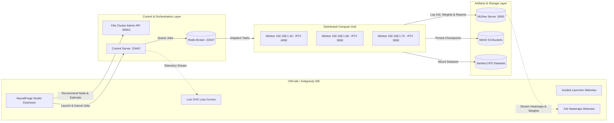

<p align="center">
  <a href="https://linkedin.com/in/wisrovi-rodriguez"></a>
  <a href="https://wisrovi.dev"></a>
  <a href="https://orcid.org/0009-0005-0710-1861"></a>
  <a href="https://opensource.org/licenses/MIT"></a>
</p>

# 🚀 NeuralForge Studio: YOLO & Cluster MLOps Suite

[](https://github.com/wisrovi/wyoloservice2_extension)
[](https://code.visualstudio.com/)
[](LICENSE)
[](https://github.com/wisrovi)

The official enterprise IDE extension for the **train_service2** ecosystem. Designed and architected by **William Rodriguez (Wisrovi)**, **NeuralForge Studio** transforms complex distributed AI infrastructure into a clean, human-centric, 3-step daily workflow for Computer Vision engineers and ML researchers.

Whether running in **VSCode**, **Google Antigravity**, or remote browser **code-server** instances, NeuralForge Studio eliminates DevOps friction: launch next-generation **YOLO26/v8** training runs with intuitive presets, monitor live experiments with real-time loss curves, inspect **Explainable AI (Eigen-CAM)** heatmaps, and download production model checkpoints (`best.pt`) directly into your open workspace with one click.

---

## 📖 Table of Contents
1. [NeuralForge Studio: Daily User Workflows](#-neuralforge-studio-daily-user-workflows)
2. [Architecture & Data Flow](#-architecture--data-flow)
3. [Key Technologies and Libraries](#-key-technologies-and-libraries)
4. [Core Feature Deep Dive](#-core-feature-deep-dive)
5. [Command Palette Reference](#-command-palette-reference)
6. [Configuration & Settings](#-configuration--settings)
7. [End-to-End Workflow Guide](#-end-to-end-workflow-guide)
8. [Building and Packaging](#-building-and-packaging)
9. [License & Commercial Terms](#-license--commercial-terms)
10. [Author & Official Affiliation](#-author--official-affiliation)

---

## 🎨 NeuralForge Studio: Daily User Workflows

Rather than overwhelming standard practitioners with low-level sysadmin metrics, **NeuralForge Studio** structures the sidebar around the real daily lifecycle of machine learning development:

```
┌────────────────────────────────────────────────────────┐
│  NEURALFORGE STUDIO                                    │
├────────────────────────────────────────────────────────┤
│  ▼ 🚀 TRAINING HUB (QUICK START)                       │
│    ▶ 🚀 Start New Training (Guided Launcher)           │
│    ▶ 🔍 Check & Validate Dataset Path                  │
│    ▶ ⚙️ Advanced Configuration (Optuna Sweeper)        │
│    ▶ 🟢 Cluster Ready: 12 GPU Nodes Online             │
├────────────────────────────────────────────────────────┤
│  ▼ 📋 MY EXPERIMENTS & RUNS                            │
│    ▼ 🟢 [RUNNING] Test_AREPO_ProtSup_v3                │
│      ▶ 📊 View Live Loss & Metrics Curves              │
│      ▶ 📜 Tail Real-Time Logs                          │
│      ▶ ⏹️ Abort / Cancel Study                         │
├────────────────────────────────────────────────────────┤
│  ▼ 🏆 MODELS & RESULTS GALLERY                         │
│    ▼ 🏆 Test_AREPO_ProtSup_v3 [mAP50: 0.932]           │
│      ▶ ⬇️ Download best.pt to Workspace                │
│      ▶ 🔥 View Explainable AI Heatmaps (CAM)           │
│      ▶ 📈 View Evaluation Curves & Confusion Matrix    │
│      ▶ 📄 Open Executive Report (.docx)                │
├────────────────────────────────────────────────────────┤
│  ▶ ⚙️ CLUSTER INFRASTRUCTURE (ADVANCED)                │
│    (Collapsed by default: Node telemetry, TDP, sockets)│
└────────────────────────────────────────────────────────┘
```

1. **🚀 Training Hub (Quick Start):**
   - **Guided Studio Launcher (`neuralforge.guidedLaunch`):** A visual single-screen wizard with dataset presets, model size selector (Nano, Small, Medium), and training scale buttons (5-epoch quick test vs. full run).
   - **Pre-flight Dataset Validator (`neuralforge.validateDataset`):** Checks train/val folder structure, YOLO label format, and bounding boxes on Samba CIFS or local disks before wasting GPU compute.
   - **Cluster Health Indicator:** Real-time indicator displaying active GPU nodes ready for allocation.

2. **📋 My Experiments & Runs:**
   - **Active Study Tracker:** Live cards for active and queued jobs across the distributed cluster.
   - **Instant Telemetry Shortcuts:** One-click live SVG loss curves, log tailing, and safe graceful cancellation (`neuralforge.cancelStudy`).

3. **🏆 Models & Results Gallery:**
   - **One-Click Model Export (`neuralforge.downloadModelWeights`):** Directly places `models/<study_id>_best.pt` into your active VSCode workspace root.
   - **Interactive XAI Heatmaps (`neuralforge.viewHeatmaps`):** Visualizes deep feature focus overlays and Deletion AUC fidelity scores.
   - **Evaluation Curves & Reports:** Instant confusion matrix, mAP50 progressions, and downloadable `.docx` executive summaries.

4. **⚙️ Cluster Infrastructure (Advanced):**
   - Kept neatly collapsed for engineers who need deep hardware telemetry: VRAM consumption gauges, GPU core load %, operating temperatures (°C), power draw vs. TDP wattage, node diagnostics (`neuralforge.diagnoseNode`), and cluster-wide Docker image pulls (`neuralforge.triggerBroadcastPull`).

---

## 🏛️ Architecture & Data Flow

<p align="center">
  
</p>

<details>
<summary><b>🔍 View Mermaid Specification</b></summary>



</details>

---

## 🛠️ Key Technologies and Libraries

The NeuralForge extension is built upon modern IDE, networking, and visualization technologies:

- **VSCode Extension API (`^1.80.0`):** Native editor integration providing custom Activity Bar views, hierarchical TreeDataProviders, bidirectional Webview message passing, dynamic CodeLens, and configuration schemas.
- **TypeScript (`^6.0.0`):** Strictly-typed codebase delivering strict null checks, clean interfaces, and robust compile-time guarantees across all telemetry providers.
- **Webpack 5:** Industrial-grade bundling, dead-code elimination, and tree-shaking that compiles all providers and styles into an optimized, self-contained `dist/extension.js` production artifact.
- **Node.js Asynchronous HTTP Client:** Non-blocking asynchronous network communication interfacing with both the Kubernetes Cluster Admin NodePort (`:30001`) and Celery Control Server REST endpoints (`:23442`).
- **HTML5 & CSS3 Responsive Webviews:** Hardware-accelerated, theme-adaptive user interfaces adhering to native VSCode design variables (`--vscode-*`) for the Guided Training Studio, XAI Heatmaps Explorer, and Metrics Curves.
- **JSON Schema (Draft-07):** Schema specification providing automated autocomplete, inline documentation tooltips, and strict linting for YOLO26 training descriptors and Optuna Sweeper v2 configurations.

---

## 🚀 Core Feature Deep Dive

### 1. 🚀 Guided Training Studio (`neuralforge.guidedLaunch`)
For daily training tasks, practitioners no longer need to write boilerplate YAML or learn Celery syntax:
* **Interactive Visual Launcher:** Choose datasets from recent Samba CIFS paths or one-click presets (`Colorball Multiclass`, `Traffic Signs`, `COCO128`).
* **Architecture Selector:** Instantly pick between **YOLO26 Nano**, **Small**, **Medium**, or baseline YOLOv8.
* **Scale Buttons:** Fast 5-epoch test run for pipeline validation or full 100/300-epoch convergence run.
* **Auto-GPU Routing:** Automatically targets the least loaded GPU worker node in the cluster.

### 2. ⬇️ One-Click Weights Download (`neuralforge.downloadModelWeights`)
When an experiment finishes, you can directly download `best.pt` with a single click in the **Models & Results Gallery**. The file is saved directly into `models/<study_id>_best.pt` within your active workspace folder, immediately ready for inference or mobile deployment.

### 3. 🔬 XAI Heatmaps & Explainability Explorer (`neuralforge.viewHeatmaps`)
When training finishes, the worker executes a 20-step scientific analysis. The extension provides an inline interactive Webview to:
* **Visualize Visual Activations:** Inspect **Eigen-CAM** and **Grad-CAM** deep-layer feature activation maps overlaying detected objects from `extras/model_focus/`.
* **Evaluate Deletion AUC Scores:** Verify fidelity metrics (Area Under the Deletion Curve) ensuring the model focuses on salient semantic features rather than background noise.
* **Inspect Adversarial Robustness:** Review accuracy degradation under **FGSM** and **PGD** gradient-based adversarial perturbations.

### 4. 📈 MLflow & Optuna Metrics Explorer Webview (`neuralforge.viewMetricsCurves`)
* Comprehensive visualization of training & validation loss curves (`train/box_loss`, `val/box_loss`, `train/cls_loss`).
* Real-time tracking of accuracy progressions: `metrics/mAP50(B)`, `metrics/mAP50-95(B)`, and `metrics/precision(B)`.
* Best trial scorecard displaying optimal epoch, validation loss, and model checkpoint status.

### 5. 📜 Real-Time Live Log Tailer (`neuralforge.streamLogs`)
Monitor training progression live directly in VSCode:
* **Live Streaming:** Polls container execution logs every 2.5 seconds into a dedicated `NeuralForge Training Logs` OutputChannel.
* **Intelligent Terminal Triggers:** Automatically detects job completion (`TRAINING_COMPLETED_SUCCESSFULLY`) or fatal exceptions, closing the stream cleanly.

### 6. ⏹️ Interactive Task Cancellation (`neuralforge.cancelStudy`)
* Abort divergence or rogue training trials with a single click from the Tasks Tree or Command Palette.
* Dispatches graceful termination signals directly to Celery invokers and evicts associated Kubernetes pods.

### 7. 🛡️ Pre-flight Dataset Health Check (`neuralforge.validateDataset`)
* Prevents wasted compute by auditing dataset paths (local or remote Samba CIFS) before launching long runs.
* Audits train/val splits, bounding box normalization, class distribution balance, and `data.yaml` validity.

### 8. 🔄 1-Click Cluster-Wide Docker Pull (`neuralforge.triggerBroadcastPull`)
* Dispatches a broadcast `force_docker_pull` control command across all active Celery invoker workers (excluding the NAS manager) to ensure all nodes run the latest executor Docker image.

---

## ⌨️ Command Palette Reference

All features are registered under the `NeuralForge` category in the Command Palette (`Ctrl+Shift+P` / `Cmd+Shift+P`):

| Command ID | Title | Description |
|---|---|---|
| `neuralforge.guidedLaunch` | **Open Guided Training Studio (Recommended)** | Opens visual single-page training launcher with presets. |
| `neuralforge.downloadModelWeights` | **Download Best Weights (best.pt) to Workspace** | Directly saves `best.pt` into the active workspace's `models/` folder. |
| `neuralforge.refreshAllViews` | **Refresh Studio Views & Active Runs** | Synchronizes all Studio view trees simultaneously. |
| `neuralforge.createConfigWizard` | **Create Training Config (Wizard)** | Opens the interactive Webview to generate YOLO26/v8 Sweeper YAMLs. |
| `neuralforge.viewHeatmaps` | **View XAI Heatmaps & Explainability** | Launches the XAI Explorer Webview for Eigen-CAM images and Deletion AUC. |
| `neuralforge.viewClusterStatus` | **Refresh Cluster Telemetry & Node Health** | Forces an immediate refresh of the cluster nodes and queues TreeView. |
| `neuralforge.global.celeryDashboard` | **Open Celery Mission Control Dashboard** | Displays live cluster overview, broker connections, and active tasks. |
| `neuralforge.recommendNode` | **Query Best Compute Node for VRAM & Load** | Recommends optimal GPU worker node based on memory headroom. |
| `neuralforge.estimateDuration` | **Estimate Study Training Duration** | Projects training completion time in hours and minutes. |
| `neuralforge.downloadSelectiveArtifact` | **Selectively Download Specific MLflow Artifact** | Retrieves `best.pt`, reports, CAMs, or LaTeX tables. |
| `neuralforge.downloadTrialArtifacts` | **Download Complete Study Artifacts (ZIP)** | Bundles all trials and checkpoints into a single archive from MLflow. |
| `neuralforge.launchTraining` | **Launch Distributed YOLO Training Study** | Submits the active configuration YAML to the cluster via MCP. |
| `neuralforge.submitTraining` | **Submit YAML Training Configuration to Cluster** | Dispatches the YAML configuration directly to Celery/Control Server. |
| `neuralforge.streamLogs` | **Stream Real-Time Training Execution Logs** | Opens dedicated OutputChannel to tail live worker container logs. |
| `neuralforge.stopLogStreaming` | **Stop Log Streaming Session** | Terminates active log polling stream. |
| `neuralforge.cancelStudy` | **Abort Running Study / Cancel Task on Cluster** | Aborts active trial and cancels Celery tasks. |
| `neuralforge.viewMetricsCurves` | **Open MLflow Metrics & Loss Curves Explorer** | Interactive Webview charting loss curves and mAP50 progressions. |
| `neuralforge.validateDataset` | **Pre-flight Validate Dataset Path and Splits** | Audits train/val splits and annotations on CIFS/local storage. |
| `neuralforge.triggerBroadcastPull` | **Broadcast Pull Latest Worker Image to All Nodes** | Forces all Celery GPU invokers to pull the latest worker Docker image. |
| `neuralforge.diagnoseNode` | **Run Deep Diagnostics on Invoker Node** | Tests socket connectivity and Celery response from worker node. |
| `neuralforge.pruneNodeDocker` | **Prune Inactive Docker Containers on Node** | Cleans up dangling containers and free disk space on remote node. |
| `neuralforge.global.viewReport` | **View Post-Train MLflow Executive Report** | Opens the descriptive post-train LLM analysis report. |
| `neuralforge.local.viewLogs` | **Stream Invoker Worker Execution Logs** | Tails live execution logs from worker executor containers. |
| `neuralforge.local.runTest` | **Run End-to-End Invoker Integration Test** | Builds local executor and runs validation test. |
| `neuralforge.global.wpipeScaffold` | **Deploy WPipe Modular Pipeline Scaffolding**| Scaffolds standard WPipe DAG pipelines. |
| `neuralforge.local.previewEDA` | **Preview Dataset Annotations (Mini-EDA)** | Previews dataset bounding boxes and class distribution. |
| `neuralforge.global.openCodeChat` | **Launch OpenCode AI Assistant Chat** | Opens interactive AI assistant for training analysis. |

---

## ⚙️ Configuration & Settings

Configure the extension via `Settings > Extensions > NeuralForge AI` or in your `settings.json`:

```json
{
  "neuralforge.controlHost": "192.168.10.252",
  "neuralforge.controlPort": 23442,
  "neuralforge.k8sAdminPort": 30001,
  "neuralforge.mlflowPort": 5000,
  "neuralforge.defaultModel": "yolo26n.pt"
}
```

* `neuralforge.controlHost`: Host IP or hostname of the Central Manager / Control Server.
* `neuralforge.controlPort`: REST API port for Celery queue status and node registrations (default: `23442`).
* `neuralforge.k8sAdminPort`: Kubernetes NodePort for the Cluster Admin API service (default: `30001`).
* `neuralforge.mlflowPort`: Port of the MLflow Tracking Server for artifacts and metrics (default: `5000`).
* `neuralforge.defaultModel`: Default base model selected when generating new configuration templates.

---

## 🧭 End-to-End Workflow Guide

1. **Verify Cluster Readiness:** Check the green indicator `🟢 Cluster Ready` in **Training Hub (Quick Start)**.
2. **Launch with Guided Studio:** Click **Start New Training (Guided Launcher)**, select your dataset preset, choose **YOLO26 Small**, and click **Start Training on Cluster**.
3. **Track Real-Time Progress:** Expand **My Experiments & Runs** to inspect live loss curves and stream container execution logs directly into your editor.
4. **Analyze Interpretability:** When training finishes, review the model under **Models & Results Gallery** to view Eigen-CAM attention heatmaps and accuracy metrics.
5. **Export Weights:** Click **⬇️ Download best.pt to Workspace** to save the optimized model weights straight into your project's `models/` directory.

---

## 📦 Building and Packaging

To compile from source and package into a `.vsix` file:

```bash
# 1. Install dependencies
npm install

# 2. Compile production bundle with Webpack
npm run --prefix . package

# 3. Package into .vsix archive
npx @vscode/vsce package --no-dependencies

# 4. Install in VSCode or Antigravity IDE
code --install-extension neuralforge-0.0.6.vsix --force
antigravity --install-extension neuralforge-0.0.6.vsix --force
```

---

## 📜 License & Commercial Terms

This project is part of the **train_service2** ecosystem and operates under a dual-licensing model:
- **Open Source:** AGPLv3 (see [`LICENSE`](LICENSE)). Any derivative work or hosted service modifying this software must disclose source code under AGPLv3.
- **Commercial:** Enterprise deployments, closed-source integrations, and commercial licensing require an official commercial license. See [`COMMERCIAL.md`](COMMERCIAL.md) or contact the author.

---

## 👤 Author & Official Affiliation

* **William Steve Rodriguez Villamizar (Wisrovi)**
* **Role:** Principal AI Engineer & Applied AI Solutions Architect | Scientific Researcher
* 📧 **Email:** [wisrovi.rodriguez@gmail.com](mailto:wisrovi.rodriguez@gmail.com)
* 🌐 **Official Portal:** [wisrovi.dev](https://wisrovi.dev)
* 💼 **LinkedIn:** [wisrovi-rodriguez](https://www.linkedin.com/in/wisrovi-rodriguez/)
* 🆔 **ORCID:** [0009-0005-0710-1861](https://orcid.org/0009-0005-0710-1861)
* 📦 **PyPI:** [pypi.org/user/wisrovi/](https://pypi.org/user/wisrovi/)
* 🐙 **GitHub:** [@wisrovi](https://github.com/wisrovi)
