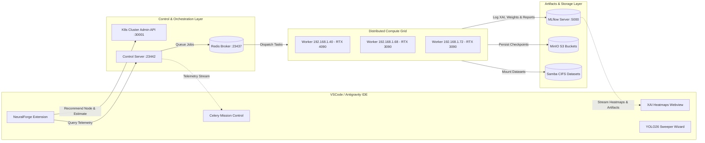

<p align="center">
  <a href="https://linkedin.com/in/wisrovi-rodriguez"></a>
  <a href="https://wisrovi.dev"></a>
  <a href="https://orcid.org/0009-0005-0710-1861"></a>
  <a href="https://opensource.org/licenses/MIT"></a>
</p>

# 🚀 NeuralForge AI: YOLO & Cluster MLOps Suite

[](https://github.com/wisrovi/wyoloservice2_extension)
[](https://code.visualstudio.com/)
[](LICENSE)
[](https://github.com/wisrovi)

The official enterprise IDE extension for the **train_service2** ecosystem. Designed and architected by **William Rodriguez (Wisrovi)**, this extension bridges the gap between modern code editors (**VSCode**, **Google Antigravity**) and enterprise distributed training infrastructure. It delivers end-to-end orchestration for next-generation **YOLO26/v8** model training, **Optuna Sweeper v2** hyperparameter tuning, **Explainable AI (XAI)** heatmaps inspection, real-time **Kubernetes & Celery** cluster telemetry, and selective **MLflow** artifact retrieval.

---

## 📖 Table of Contents
1. [Architecture & Data Flow](#-architecture--data-flow)
2. [Key Technologies and Libraries](#-key-technologies-and-libraries)
3. [Core Feature Deep Dive](#-core-feature-deep-dive)
4. [Command Palette Reference](#-command-palette-reference)
5. [Configuration & Settings](#-configuration--settings)
6. [End-to-End Workflow Guide](#-end-to-end-workflow-guide)
7. [Building and Packaging](#-building-and-packaging)
8. [License & Commercial Terms](#-license--commercial-terms)
9. [Author & Official Affiliation](#-author--official-affiliation)

---

## 🏛️ Architecture & Data Flow

<p align="center">
  
</p>

<details>
<summary><b>🔍 View Mermaid Specification</b></summary>



</details>

---

## 🛠️ Key Technologies and Libraries

The NeuralForge extension is built upon modern IDE, networking, and visualization technologies:

- **VSCode Extension API (`^1.80.0`):** Native editor integration providing custom Activity Bar views, hierarchical TreeDataProviders, bidirectional Webview message passing, dynamic CodeLens, and configuration schemas.
- **TypeScript (`^6.0.0`):** Strictly-typed codebase delivering strict null checks, clean interfaces, and robust compile-time guarantees across all telemetry providers.
- **Webpack 5:** Industrial-grade bundling, dead-code elimination, and tree-shaking that compiles all providers and styles into an optimized, self-contained `dist/extension.js` production artifact.
- **Node.js Asynchronous HTTP Client:** Non-blocking asynchronous network communication interfacing with both the Kubernetes Cluster Admin NodePort (`:30001`) and Celery Control Server REST endpoints (`:23442`).
- **HTML5 & CSS3 Responsive Webviews:** Hardware-accelerated, theme-adaptive user interfaces adhering to native VSCode design variables (`--vscode-*`) for the XAI Heatmaps Explorer, Configuration Wizard, and Mission Control Dashboard.
- **JSON Schema (Draft-07):** Schema specification providing automated autocomplete, inline documentation tooltips, and strict linting for YOLO26 training descriptors and Optuna Sweeper v2 configurations.

---

## 🚀 Core Feature Deep Dive

### 1. 🔬 XAI Heatmaps & Explainability Explorer (`neuralforge.viewHeatmaps`)
Modern computer vision demands interpretability. When training finishes, the worker executes a 20-step scientific analysis. The extension provides an inline interactive Webview to:
* **Visualize Visual Activations:** Inspect **Eigen-CAM** and **Grad-CAM** deep-layer feature activation maps overlaying detected objects from `extras/model_focus/`.
* **Evaluate Deletion AUC Scores:** Verify fidelity metrics (Area Under the Deletion Curve) ensuring the model focuses on salient semantic features rather than background noise.
* **Inspect Adversarial Robustness:** Review accuracy degradation under **FGSM** and **PGD** gradient-based adversarial perturbations.
* **Direct Actions:** One-click shortcuts to download final model weights (`best.pt`) or open the descriptive post-train executive report.

### 2. ⚡ Live Cluster Telemetry & Celery Mission Control
Say goodbye to black-box distributed computing. The extension connects directly to live cluster APIs:
* **Cluster TreeView (`neuralforgeCluster`):** Displays real-time status of the central Manager node (`NAS_Train_service`), individual GPU invoker nodes (e.g. `worker-cima0065d (192.168.1.68) [Active GPU Worker]`), and active/queued Celery tasks.
* **Celery Mission Control Dashboard (`neuralforge.global.celeryDashboard`):** High-level view showing Redis broker health, total connected clients, GPU worker queue distribution (`gpus_high`, `gpus_medium`, `wyolo_gpu_queue`), and active study progress.

### 3. 🎯 Next-Gen YOLO26 & Optuna Sweeper v2 Wizard (`neuralforge.createConfigWizard`)
An intuitive, structured wizard that creates production-ready YAML descriptors:
* **Architectures:** Supports **YOLO26** (`yolo26n.pt`, `yolo26s.pt`, `yolo26m.pt`, `yolo26l.pt`), YOLOv8, and RT-DETR.
* **Multi-Task CV Tasks:** Object Detection, Instance Segmentation, Image Classification, Oriented Bounding Boxes (**OBB**), and Pose / Keypoints.
* **Hyperparameter Sweeper (Optuna):** Configurable samplers (**TPE** or **CMA-ES**), direction, trial counts, and automatic metric mapping (e.g. `metrics/mAP50-95(B)`, `metrics/mAP50-95(M)`, `metrics/mAP50-95(P)`).
* **Scheduling & Private Allocation:** Target specific worker IPs (`target_worker`) and schedule off-peak execution (`start_at: "22:00"`).
* **Post-Train Module Toggles:** Granular control to enable or disable XAI, Adversarial testing, and PyLaTeX scientific report generation.

### 4. 📦 Selective MLflow Artifacts Downloader (`neuralforge.downloadSelectiveArtifact`)
Avoid downloading multi-gigabyte ZIP archives containing checkpoints for dozens of unpromising trials. Surgically download only the critical assets:
* **Best Checkpoint:** `weights/best.pt` directly into your workspace.
* **Executive Reports:** `report/LLM_Report.docx` or `GLOBAL_RESEARCH_EXPLANATION.md`.
* **Heatmap Gallery:** `extras/model_focus/` CAM images for presentations and paper figures.
* **LaTeX Tables:** `latex/table_results.tex` generated via PyLaTeX for scientific publication.

### 5. 🤖 Node Recommender & Training Duration Estimator
* **Recommend Node (`neuralforge.recommendNode`):** Queries the Kubernetes scheduler algorithm to identify the optimal worker node based on minimum VRAM requirements and current temperature.
* **Estimate Duration (`neuralforge.estimateDuration`):** Computes reliable training duration estimates before submitting jobs.

### 6. 🚀 1-Click Training Submission & YAML CodeLens (`neuralforge.submitTraining`)
No more switching between terminal commands or external web interfaces to launch distributed training:
* **Interactive CodeLens:** Directly inside any `training.yaml` file, click `$(play) Launch NeuralForge Training` to dispatch the task.
* **Automatic Study ID Registration:** The cluster response is intercepted, and the unique `study_id` is automatically persisted back into your YAML document.
* **Multi-Priority Queuing:** Seamlessly select between high, medium, and low Celery priority queues (`gpus_high`, `gpus_medium`, `gpus_low`) or direct worker targeting.

### 7. 📜 Real-Time Live Log Tailer (`neuralforge.streamLogs`)
Monitor training progression live directly in VSCode:
* **Live Streaming:** Polls container execution logs every 2.5 seconds into a dedicated `NeuralForge Training Logs` OutputChannel.
* **Intelligent Terminal Triggers:** Automatically detects job completion (`TRAINING_COMPLETED_SUCCESSFULLY`) or fatal exceptions, closing the stream cleanly.

### 8. ⏹️ Interactive Task Cancellation (`neuralforge.cancelStudy`)
* Abort divergence or rogue training trials with a single click from the Tasks Tree or Command Palette.
* Dispatches graceful termination signals directly to Celery invokers and evicts associated Kubernetes pods.

### 9. 📊 Hardware Telemetry Gauges & Physical Node Monitoring
* Deep hardware metrics for each GPU node: VRAM memory usage bars, GPU core utilization %, operating temperatures (°C), power draw vs TDP wattage, and host CPU/RAM allocations.
* Administrative shortcuts: Run connectivity diagnostics (`neuralforge.diagnoseNode`) or prune dangling Docker containers on nodes (`neuralforge.pruneNodeDocker`).

### 10. 📈 MLflow & Optuna Metrics Explorer Webview (`neuralforge.viewMetricsCurves`)
* Comprehensive visualization of training & validation loss curves (`train/box_loss`, `val/box_loss`, `train/cls_loss`).
* Real-time tracking of accuracy progressions: `metrics/mAP50(B)`, `metrics/mAP50-95(B)`, and `metrics/precision(B)`.
* Best trial scorecard displaying optimal epoch, validation loss, and model checkpoint status.

### 11. 🛡️ Pre-flight Dataset Health Check (`neuralforge.validateDataset`)
* Prevents wasted compute by auditing dataset paths (local or remote Samba CIFS) before launching long runs.
* Audits train/val splits, bounding box normalization, class distribution balance, and `data.yaml` validity.

### 12. 🔄 1-Click Cluster-Wide Docker Pull (`neuralforge.triggerBroadcastPull`)
* Dispatches a broadcast `force_docker_pull` control command across all active Celery invoker workers (excluding the NAS manager) to ensure all nodes run the latest executor Docker image.

---

## ⌨️ Command Palette Reference

All features are registered under the `NeuralForge` category in the Command Palette (`Ctrl+Shift+P` / `Cmd+Shift+P`):

| Command ID | Title | Description |
|---|---|---|
| `neuralforge.createConfigWizard` | **Create Training Config (Wizard)** | Opens the interactive Webview to generate YOLO26/v8 Sweeper YAMLs. |
| `neuralforge.viewHeatmaps` | **View XAI Heatmaps & Explainability** | Launches the XAI Explorer Webview for Eigen-CAM images and Deletion AUC. |
| `neuralforge.viewClusterStatus` | **Refresh Cluster Telemetry & Node Health** | Forces an immediate refresh of the cluster nodes and queues TreeView. |
| `neuralforge.global.celeryDashboard` | **Open Celery Mission Control Dashboard** | Displays live cluster overview, broker connections, and active tasks. |
| `neuralforge.recommendNode` | **Query Best Compute Node for VRAM & Load** | Recommends optimal GPU worker node based on memory headroom. |
| `neuralforge.estimateDuration` | **Estimate Study Training Duration** | Projects training completion time in hours and minutes. |
| `neuralforge.downloadSelectiveArtifact` | **Selectively Download Specific MLflow Artifact** | Surgically retrieves `best.pt`, reports, CAMs, or LaTeX tables. |
| `neuralforge.downloadTrialArtifacts` | **Download Complete Study Artifacts (ZIP)** | Bundles all trials and checkpoints into a single archive from MLflow. |
| `neuralforge.launchTraining` | **Launch Distributed YOLO Training Study** | Submits the active configuration YAML to the cluster via MCP. |
| `neuralforge.submitTraining` | **Submit YAML Training Configuration to Cluster** | Dispatches the YAML configuration directly to Celery/Control Server. |
| `neuralforge.streamLogs` | **Stream Real-Time Training Execution Logs** | Opens dedicated OutputChannel to tail live worker container logs. |
| `neuralforge.stopLogStreaming` | **Stop Log Streaming Session** | Terminates active log polling stream. |
| `neuralforge.cancelStudy` | **Abort Running Study / Cancel Task on Cluster** | Aborts active trial and cancels Celery tasks. |
| `neuralforge.viewMetricsCurves` | **Open MLflow Metrics & Loss Curves Explorer** | Interactive Webview charting loss curves and mAP50 progressions. |
| `neuralforge.validateDataset` | **Pre-flight Validate Dataset Path and Splits** | Audits train/val splits and annotations on CIFS/local storage. |
| `neuralforge.triggerBroadcastPull` | **Broadcast Pull Latest Worker Image to All Nodes** | Forces all Celery GPU invokers to pull the latest worker Docker image. |
| `neuralforge.diagnoseNode` | **Run Deep Diagnostics on Invoker Node** | Tests socket connectivity and Celery response from worker node. |
| `neuralforge.pruneNodeDocker` | **Prune Inactive Docker Containers on Node** | Cleans up dangling containers and free disk space on remote node. |
| `neuralforge.global.viewReport` | **View Post-Train MLflow Executive Report** | Opens the descriptive post-train LLM analysis report. |
| `neuralforge.local.viewLogs` | **Stream Invoker Worker Execution Logs** | Tails live execution logs from worker executor containers. |
| `neuralforge.local.runTest` | **Run End-to-End Invoker Integration Test** | Builds local executor and runs validation test. |
| `neuralforge.global.wpipeScaffold` | **Deploy WPipe Modular Pipeline Scaffolding**| Scaffolds standard WPipe DAG pipelines. |
| `neuralforge.local.previewEDA` | **Preview Dataset Annotations (Mini-EDA)** | Previews dataset bounding boxes and class distribution. |
| `neuralforge.global.openCodeChat` | **Launch OpenCode AI Assistant Chat** | Opens interactive AI assistant for training analysis. |

---

## ⚙️ Configuration & Settings

Configure the extension via `Settings > Extensions > NeuralForge AI` or in your `settings.json`:

```json
{
  "neuralforge.controlHost": "192.168.10.252",
  "neuralforge.controlPort": 23442,
  "neuralforge.k8sAdminPort": 30001,
  "neuralforge.mlflowPort": 5000,
  "neuralforge.defaultModel": "yolo26n.pt"
}
```

* `neuralforge.controlHost`: Host IP or hostname of the Central Manager / Control Server.
* `neuralforge.controlPort`: REST API port for Celery queue status and node registrations (default: `23442`).
* `neuralforge.k8sAdminPort`: Kubernetes NodePort for the Cluster Admin API service (default: `30001`).
* `neuralforge.mlflowPort`: Port of the MLflow Tracking Server for artifacts and metrics (default: `5000`).
* `neuralforge.defaultModel`: Default base model selected when generating new configuration templates.

---

## 🧭 End-to-End Workflow Guide

1. **Verify Cluster Health:** Open the **NeuralForge** Activity Bar tab to view active nodes under `Cluster Infrastructure & Nodes`.
2. **Generate Configuration:** Execute `NeuralForge: Open YOLO26 / Optuna Sweeper Configuration Wizard`, select your dataset path, architecture, and post-train explainability options, then click **Generate NeuralForge YAML**.
3. **Inspect & Validate:** Open the generated `.yaml` file. The built-in JSON schema automatically lints all fields and highlights parameter errors.
4. **Launch Training:** Click the CodeLens action `🚀 Launch Training via MCP` at the top of the YAML file.
5. **Monitor Progress:** Open the **Celery Mission Control Dashboard** to watch epochs advance across the assigned GPU invokers.
6. **Analyze Interpretability:** When training finishes, run `NeuralForge (Global): Open XAI Heatmaps & Explainability Explorer` to review Eigen-CAM heatmaps and Deletion AUC fidelity.
7. **Export Checkpoint:** Use `NeuralForge (Global): Selectively Download Specific MLflow Artifact` to pull the optimized `best.pt` directly into your deployment repository.

---

## 📦 Building and Packaging

To compile from source and package into a `.vsix` file:

```bash
# 1. Install dependencies
npm install

# 2. Compile production bundle with Webpack
npm run --prefix . package

# 3. Package into .vsix archive
npx @vscode/vsce package --no-dependencies

# 4. Install in VSCode or Antigravity IDE
code --install-extension neuralforge-0.0.3.vsix --force
antigravity --install-extension neuralforge-0.0.3.vsix --force
```

---

## 📜 License & Commercial Terms

This project is part of the **train_service2** ecosystem and operates under a dual-licensing model:
- **Open Source:** AGPLv3 (see [`LICENSE`](LICENSE)). Any derivative work or hosted service modifying this software must disclose source code under AGPLv3.
- **Commercial:** Enterprise deployments, closed-source integrations, and commercial licensing require an official commercial license. See [`COMMERCIAL.md`](COMMERCIAL.md) or contact the author.

---

## 👤 Author & Official Affiliation

* **William Steve Rodriguez Villamizar (Wisrovi)**
* **Role:** Principal AI Engineer & Applied AI Solutions Architect | Scientific Researcher
* 📧 **Email:** [wisrovi.rodriguez@gmail.com](mailto:wisrovi.rodriguez@gmail.com)
* 🌐 **Official Portal:** [wisrovi.dev](https://wisrovi.dev)
* 💼 **LinkedIn:** [wisrovi-rodriguez](https://www.linkedin.com/in/wisrovi-rodriguez/)
* 🆔 **ORCID:** [0009-0005-0710-1861](https://orcid.org/0009-0005-0710-1861)
* 📦 **PyPI:** [pypi.org/user/wisrovi/](https://pypi.org/user/wisrovi/)
* 🐙 **GitHub:** [@wisrovi](https://github.com/wisrovi)
