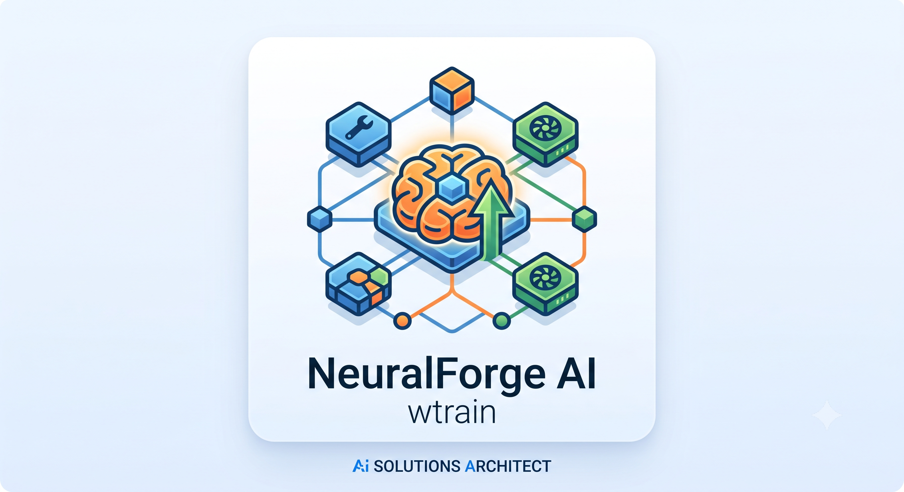

<p align="center">
  <a href="https://linkedin.com/in/wisrovi-rodriguez"></a>
  <a href="https://wisrovi.dev"></a>
  <a href="https://orcid.org/0009-0005-0710-1861"></a>
  <a href="https://opensource.org/licenses/MIT"></a>
</p>

# NeuralForge Extension



This is the official VSCode / Antigravity IDE Extension for the **train_service2** ecosystem. It integrates tightly with the NeuralForgeAI cluster through the local MCP Server and Kubernetes Cluster Admin API, allowing you to monitor distributed GPU workers, generate next-generation YOLO26 sweep configurations, inspect Explainable AI (XAI) heatmaps, and selectively download trial artifacts directly inside your editor.

---

## 🛠️ Key Technologies and Libraries

The NeuralForge extension is built upon modern IDE and web technologies:

- **VSCode Extension API (`^1.80.0`):** Native IDE integration including TreeView providers, Webview panels, CodeLens, custom commands, and configuration schemas.
- **TypeScript (`^6.0.0`):** Strictly-typed codebase ensuring high reliability, maintainability, and seamless compilation.
- **Webpack 5:** High-performance module bundling and tree-shaking for lean production `.vsix` packaging.
- **Node.js HTTP Client:** Asynchronous non-blocking communication with the Kubernetes Cluster Admin API and Celery Control Servers.
- **HTML5 / CSS3 Responsive Webviews:** Interactive, themed user interfaces matching the active VSCode theme for both the XAI Heatmaps Explorer, Configuration Wizard, and Celery Mission Control.
- **JSON Schema (Draft-07):** Deep YAML IntelliSense and automated validation for YOLO26 training descriptors and Optuna sweeper configurations.

---

## 🚀 Key Features

### 1. 🔬 XAI Heatmaps & Explainability Explorer
Open interactive visual activation maps (`neuralforge.viewHeatmaps`) generated during the post-training pipeline. Visualize deep-layer attention overlays (**Eigen-CAM** / **Grad-CAM**) from `extras/model_focus/`, verify **Deletion AUC fidelity scores**, and review adversarial robustness metrics directly inside your workspace.

### 2. ⚡ Live Cluster & Invoker Monitoring
The `ClusterTreeProvider` and Celery Mission Control dashboard query real-time Kubernetes cluster telemetry (`/health`, `/workers`, `/tasks`), showing GPU node health, VRAM allocations, active worker queues, and running studies.

### 3. 🎯 Next-Gen YOLO26 Configuration Wizard
Interactive webview wizard (`neuralforge.createConfigWizard`) supporting:
- **Model Architectures:** YOLO26 family (`yolo26n.pt`, `yolo26s.pt`, `yolo26m.pt`, `yolo26l.pt`), classic YOLOv8, and RT-DETR.
- **Multi-Task CV Targets:** Object Detection, Instance Segmentation, Classification, Oriented Bounding Boxes (OBB), and Pose Estimation.
- **Post-Train Explainability Toggles:** Enable or disable XAI heatmaps, Adversarial testing, and PyLaTeX scientific table exports.
- **Optuna Sweeper v2:** Configurable samplers (`tpe`, `cmaes`), trial counts, private worker queues, and time-bounded trial caps.

### 4. 📦 Selective MLflow Artifacts Downloader
Rather than downloading multi-gigabyte ZIP archives containing all trials, surgically download only what you need:
- `best.pt` (Final model weights)
- `LLM_Report.docx` / `GLOBAL_RESEARCH_EXPLANATION.md` (Descriptive post-train analysis)
- `extras/model_focus/` (Eigen-CAM heatmaps)
- `table_results.tex` (PyLaTeX scientific tables)

### 5. 🤖 Intelligent Node Recommender & Estimator
Query the Kubernetes cluster scheduler to recommend the optimal compute node based on available VRAM and node temperature, or estimate training time before launching.

---

## ⚙️ Building and Packaging

To compile and package the extension into a `.vsix` bundle:

```bash
# 1. Compile production bundle with Webpack
npm run --prefix . package

# 2. Package into .vsix archive
npx @vscode/vsce package --no-dependencies

# 3. Install locally in Antigravity or VSCode
antigravity --install-extension neuralforge-0.0.3.vsix --force
code --install-extension neuralforge-0.0.3.vsix --force
```

---

## 📜 License

This project follows the dual-licensing structure of the **train_service2** ecosystem:
- Open Source: AGPLv3 (see `LICENSE`)
- Commercial: See `COMMERCIAL.md`

---

## 👤 Autor & Afiliación Oficial

* **William Steve Rodriguez Villamizar (Wisrovi)**
* **Cargo:** Principal AI Engineer & Applied AI Solutions Architect | Scientific Researcher
* 📧 **Email:** [wisrovi.rodriguez@gmail.com](mailto:wisrovi.rodriguez@gmail.com)
* 🌐 **Portal Oficial:** [wisrovi.dev](https://wisrovi.dev)
* 💼 **LinkedIn:** [wisrovi-rodriguez](https://www.linkedin.com/in/wisrovi-rodriguez/)
* 🆔 **ORCID:** [0009-0005-0710-1861](https://orcid.org/0009-0005-0710-1861)
* 📦 **PyPI:** [pypi.org/user/wisrovi/](https://pypi.org/user/wisrovi/)
* 🐙 **GitHub:** [@wisrovi](https://github.com/wisrovi)
